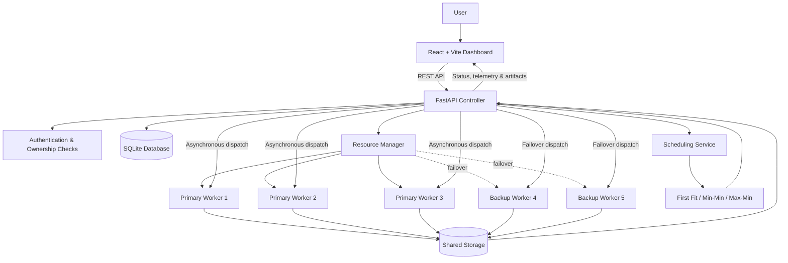

# CloudCluster

### Resource-Aware Distributed Workload Management & Optimization Platform

CloudCluster is a containerized mini-cloud platform that distributes file-processing workloads across a monitored worker fleet. It combines **resource monitoring, workload scheduling, asynchronous execution, task tracking, and a web dashboard** to demonstrate core concepts from Operating Systems, Design and Analysis of Algorithms, Database Management Systems, and Computer Networks.

The platform provides a central FastAPI controller, five Docker-based worker nodes, a React dashboard, and scheduling strategies that consider workload type, estimated execution time, and current worker load.

---

## Table of Contents

- [What CloudCluster Does](#what-cloudcluster-does)
- [Key Features](#key-features)
- [Supported Workloads](#supported-workloads)
- [Architecture](#architecture)
- [Scheduling Strategy](#scheduling-strategy)
- [Task Lifecycle](#task-lifecycle)
- [Technology Stack](#technology-stack)
- [Repository Structure](#repository-structure)
- [Getting Started](#getting-started)
- [Configuration and Security](#configuration-and-security)
- [Limits and Notes](#limits-and-notes)
- [API Documentation](#api-documentation)

---

## What CloudCluster Does

A user submits one or more processing jobs through the dashboard. The controller validates the request, checks worker availability and capabilities, selects a scheduling strategy, assigns each job to an eligible worker, and dispatches execution asynchronously. The dashboard then displays task progress, queue position, worker telemetry, and generated output.

This provides a practical demonstration of how a small distributed compute cluster can coordinate workloads instead of executing every job on a single application process.

## Key Features

- **Distributed worker fleet:** Five containerized workers managed by a central controller. Nodes 1–3 are primary workers; nodes 4–5 are designated backups.
- **Standby and failover handling:** Backup workers remain out of scheduling rotation while the primary fleet is healthy and become eligible when a primary worker is unavailable.
- **Resource-aware scheduling:** First Fit, Min-Min, and Max-Min strategies are selected using workload type and input size. The scheduler considers worker CPU/RAM telemetry, estimated execution time, existing assignments, and queue positions.
- **Batch workload submission:** Submit multiple jobs together and distribute them across eligible workers.
- **Live cluster monitoring:** View worker availability, CPU usage, memory usage, provisioned capacity, and workload counts. Telemetry is refreshed by the dashboard approximately once per second.
- **Execution history:** Search, filter, sort, inspect, export, and delete recorded workloads.
- **Output preview and download:** View supported generated artifacts in the dashboard and download completed results.
- **Analytics dashboard:** Explore workload activity, workload categories, task lifecycle distribution, CPU trends, and worker comparisons.
- **Account-based access:** Registration and login protect task history and generated artifacts so users can access only their own work.
- **Container orchestration:** Docker Compose starts the controller and worker services on a private bridge network.

## Supported Workloads

The main dashboard currently exposes these six workload types:

| Category | Workload | Input | Result |
|---|---|---|---|
| Quick | Link QR maker | HTTP or HTTPS URL | Downloadable QR-code PNG |
| Quick | Data preprocessing | CSV file | Cleaned CSV with standardized cells/headers, blank rows removed, and duplicate records removed |
| Standard | CSV ↔ JSON | CSV or JSON file | Converted CSV or JSON data |
| Standard | Image optimizer | PNG, JPG, JPEG, or WebP | Resized/compressed WebP image |
| Advanced | PDF brief | PDF file | PDF text and metadata summary, including page/word information and frequent terms |
| Advanced | File integrity check | Any supported file | SHA-256 checksum and file metadata report |

The workload dispatcher supports mixed batches, so different workload types can be queued in the same submission.

## Architecture

### High-level flow



### Main components

| Component | Responsibility |
|---|---|
| React dashboard | Authentication UI, cluster overview, workload dispatcher, execution ledger, fleet view, analytics, and output studio |
| FastAPI controller | REST endpoints, validation, authentication, task lifecycle, scheduling coordination, and worker dispatch |
| Resource Manager | Polls worker health endpoints and gathers CPU, RAM, capacity, and availability information |
| Scheduler Service | Selects an algorithm and eligible worker for each submitted workload |
| Worker nodes | Execute supported processors and return execution results and resource metrics |
| SQLAlchemy + SQLite | Store users, sessions, workload records, status, assignments, and execution metrics |
| Shared storage | Hold uploaded input files, intermediate files, and generated results |

## Scheduling Strategy

CloudCluster uses three classic scheduling approaches:

| Algorithm | Intended use | Scheduling objective |
|---|---|---|
| **First Fit** | Quick workloads and very small inputs | Assign to the next eligible worker in the candidate list |
| **Min-Min** | Moderate workloads | Prefer the job/worker assignment with the smallest estimated completion time |
| **Max-Min** | PDF and larger inputs | Prioritize the job whose best estimated completion time is greatest |

The algorithm is selected automatically using the workload type and input-file size. Execution-time estimates use file size, a workload-specific complexity weight, worker CPU capacity, and current CPU load.

The scheduler also accounts for existing worker queues and assigns a queue position for each worker. Backup nodes are considered when the primary fleet has a failure and a backup is reachable.

## Task Lifecycle

A workload is recorded and tracked through these states:

```text
SUBMITTED → QUEUED → RUNNING → COMPLETED
                              ↘ FAILED
```

The dashboard shows the assigned worker, selected algorithm, queue position, execution time, and available CPU/RAM metrics. Completed jobs can expose their output artifact through authenticated routes.

## Technology Stack

| Layer | Technologies |
|---|---|
| Frontend | React 19, Vite, JavaScript, CSS Modules |
| UI and visualization | Lucide React, Framer Motion, Chart.js, react-chartjs-2 |
| Backend API | Python, FastAPI, Uvicorn, Pydantic |
| Database layer | SQLAlchemy, SQLite |
| Scheduling and monitoring | Python scheduling modules, psutil, Requests |
| Workload processing | Pandas, NumPy, Pillow, pypdf, qrcode, SciPy, Matplotlib |
| Infrastructure | Docker, Docker Compose |

## Repository Structure

```text
CloudCluster/
├── controller/                 # FastAPI controller and orchestration services
│   ├── main.py                 # API routes, authentication, task submission
│   ├── database.py             # Database engine and sessions
│   ├── resource_manager.py     # Worker health and resource monitoring
│   ├── task_manager.py         # Task creation and lifecycle updates
│   ├── scheduler_service.py    # Scheduling and worker assignment
│   └── execution_service.py   # Asynchronous worker dispatch
│
├── frontend/                   # React + Vite dashboard
│   └── src/
│       └── components/         # Dashboard, fleet, workload, history, analytics
│
├── nodes/                      # Worker runtime and worker Dockerfiles
│   ├── node1/
│   ├── node2/
│   ├── node3/
│   └── worker_runtime.py
│
├── schedulers/                 # Scheduling algorithms and estimators
│   ├── first_fit.py
│   ├── min_min.py
│   ├── max_min.py
│   ├── capabilities.py
│   └── execution_estimator.py
│
├── models/                     # SQLAlchemy data models
├── tasks/                      # Workload processor implementations
├── storage/                    # Runtime uploads, processing and results
├── tests/                      # Automated tests
├── cloudcluster-studio/        # Separate Studio workspace; see its own README
├── docker-compose.yml          # Controller and five-worker orchestration
├── requirements.txt            # Python dependencies
├── package.json                # Root convenience scripts
└── README.md
```

## Getting Started

### Prerequisites

Choose either the Docker setup or the local setup.

- **Docker setup:** Docker Desktop with Docker Compose.
- **Local setup:** Python with pip, and Node.js with npm.

### Option 1: Run the controller and worker cluster with Docker Compose

From the repository root:

```bash
docker compose up --build
```

To run in the background:

```bash
docker compose up --build -d
```

Check the running services:

```bash
docker compose ps
```

The Compose configuration exposes these endpoints:

| Service | Local URL |
|---|---|
| Controller API | http://localhost:8000 |
| Interactive API documentation | http://localhost:8000/docs |
| Worker 1 health | http://localhost:8001/health |
| Worker 2 health | http://localhost:8002/health |
| Worker 3 health | http://localhost:8003/health |
| Backup worker 4 health | http://localhost:8004/health |
| Backup worker 5 health | http://localhost:8005/health |

The Compose file starts the controller and worker services. To use the React development dashboard, start the frontend separately using the instructions below.

Stop the cluster with:

```bash
docker compose down
```

### Option 2: Run locally without Docker

**1. Create and activate a Python virtual environment (recommended):**

Windows PowerShell:

```powershell
python -m venv .venv
.venv\Scripts\Activate.ps1
```

macOS/Linux:

```bash
python3 -m venv .venv
source .venv/bin/activate
```

**2. Install backend dependencies from the repository root:**

```bash
pip install -r requirements.txt
```

**3. Start the FastAPI controller from the repository root:**

```bash
uvicorn controller.main:app --host 0.0.0.0 --port 8000 --reload
```

**4. Open a second terminal and start the frontend:**

```bash
cd frontend
npm install
npm run dev
```

**5. Open the dashboard:**

- Dashboard: http://localhost:5173
- API documentation: http://localhost:8000/docs

The Vite development server proxies API requests to the controller on port 8000.

## Configuration and Security

- Set `CLOUDCLUSTER_JWT_SECRET` to a private value of at least 32 bytes when configuring a deployment.
- For local development, the controller creates and reuses an ignored `.jwt-secret` file if the environment variable is not set.
- Docker Compose uses a controller-only named volume for the signing key; worker containers do not need access to it.
- Passwords are stored using salted PBKDF2-HMAC-SHA256 hashes.
- Access tokens are signed with HS256, have a 30-day expiry, and are checked against a server-side session record. Logging out revokes that session.
- Task history and artifact routes enforce task ownership. Uploaded inputs and generated outputs should not be exposed as public static files.
- Keep `.env`, `.jwt-secret`, database files, and private user uploads out of Git. Never commit API keys, passwords, signing keys, or real user data.

For PowerShell, you can set a secret for the current terminal session before starting the controller:

```powershell
$env:CLOUDCLUSTER_JWT_SECRET = "replace-with-a-private-secret-of-at-least-32-bytes"
```

Use a unique secret in each deployment environment. Do not use the example value above.

## Limits and Notes

- Maximum individual file upload: **20 MB**.
- Maximum batch size: **50 work items**.
- Maximum combined batch file size: **100 MB**.
- PDF brief processing is limited to **500 pages**.
- Backup workers are designated for failover; they are not included in normal scheduling while the primary fleet is healthy.
- The root `cloudcluster-studio/` directory is a separate workspace with its own implementation and setup instructions. Refer to [cloudcluster-studio/README.md](cloudcluster-studio/README.md) before running that workspace; its runtime and workload details are distinct from the main Docker-based cluster described here.

## API Documentation

When the controller is running, FastAPI provides interactive API documentation at:

- Swagger UI: http://localhost:8000/docs
- OpenAPI schema: http://localhost:8000/openapi.json

Useful endpoints include:

| Endpoint | Purpose |
|---|---|
| `GET /api/health` | Controller health |
| `GET /nodes/status` | Worker status and resource telemetry |
| `POST /api/auth/register` | Create an account |
| `POST /api/auth/login` | Sign in |
| `POST /api/auth/logout` | Revoke the current session |
| `GET /api/auth/me` | Get the authenticated user's profile |
| `POST /tasks/submit` | Submit a workload |
| `GET /tasks` | List the current user's workloads |

See the interactive API docs for request schemas and the complete endpoint list.

---

**CloudCluster** demonstrates how operating-system resource monitoring, algorithmic scheduling, database-backed task tracking, and networked worker execution can be combined into a practical distributed workload platform.
